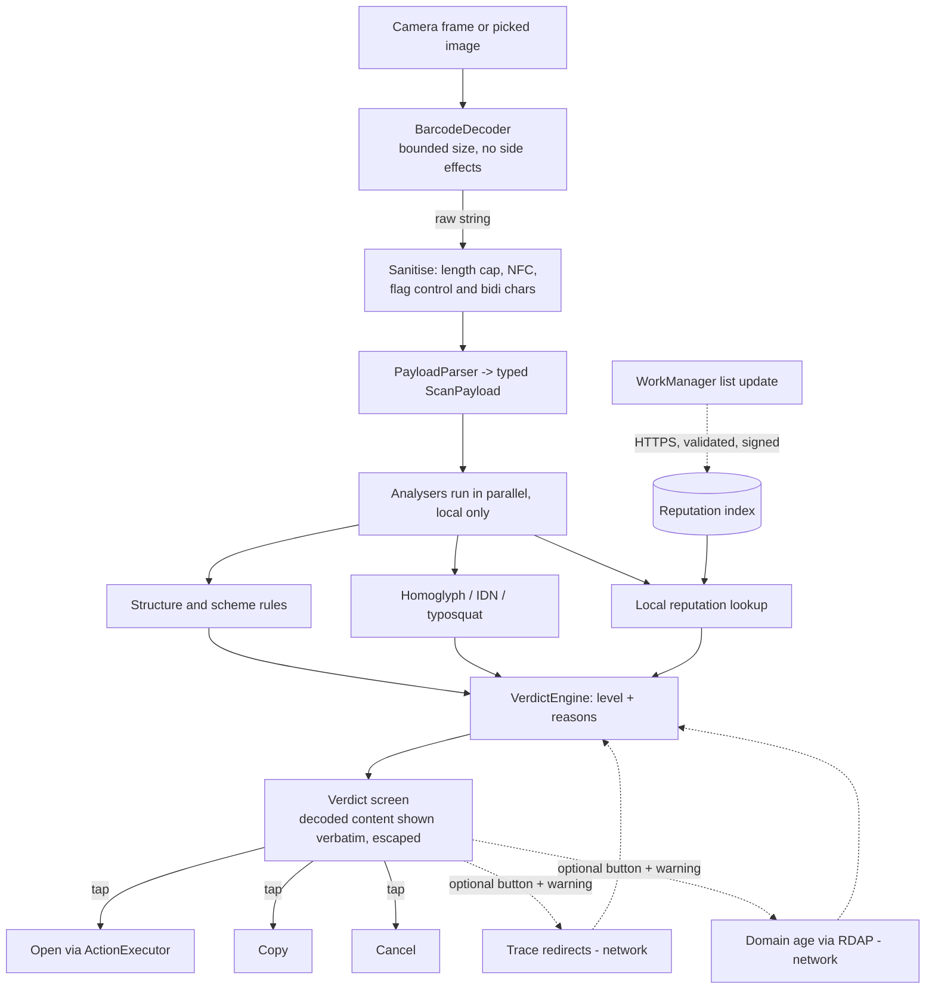

# LookFirst architecture

Status: proposed (LF-1). Stack: Kotlin, Jetpack Compose, MVVM + Clean Architecture, Hilt, minSdk 23.

## Principles

1. **Nothing runs automatically.** A scan only produces a decoded, analysed result. Opening, copying or joining is always a user tap (ADR-0003).
2. **Local by default.** All analysis is on-device (ADR-0001). The only network use is list updates (ADR-0002) and two optional, user-triggered actions (ADR-0004).
3. **Decode, then analyse the decoded structure,** never the raw string. Analysers receive typed objects, not text.
4. **Honest verdicts.** The app never says "safe" (see Verdict model).

## Layers and modules

Gradle modules are suggested; they can start as packages and be split later. Dependencies point inward only: `ui -> domain <- data`.

| Layer | Module / package | Responsibility |
|---|---|---|
| Presentation | `ui` (Compose, ViewModels) | Camera screen, verdict screen, action buttons, settings, history screen |
| Domain | `domain` (pure Kotlin, no Android) | Models (`ScanPayload`, `Verdict`, `Reason`), use cases (`AnalyzeScan`, `ResolveRedirects`, `LookupDomainAge`), analyser interfaces |
| Domain | `domain.parser` | `PayloadParser`: raw string -> sealed `ScanPayload` (Url, Wifi, Sms, Tel, Mail, Otpauth, Epc, Crypto, AppLink, Text, Unknown). Strict size and charset limits |
| Domain | `domain.analysis` | Analysers, each `ScanPayload -> List<Signal>`: `UrlStructure` (userinfo `@` tricks, IP host, odd ports, shorteners), `HomoglyphIdn` (punycode, mixed scripts, confusables, bidi), `Typosquatting` (edit distance vs an embedded brand list), `Reputation` (local list lookup), per-type rules (`WifiRules`, `OtpauthRules`, `PaymentRules`, `SchemeRules`, `SmsRules`) |
| Domain | `domain.verdict` | `VerdictEngine`: merges signals into a level and ordered reasons |
| Data | `data.scan.camera` | CameraX + `BarcodeDecoder`, frame analysis, torch |
| Data | `data.scan.image` | Photo Picker / `ACTION_OPEN_DOCUMENT`, bounded bitmap decoding, same decoder |
| Data | `data.reputation` | Compact on-disk index, `ReputationStore`, `ListUpdater` (WorkManager) |
| Data | `data.network` | The only package that talks to the network: `ListDownloader`, `RedirectTracer`, `RdapClient` (OkHttp, no cookies, no auth, fixed generic UA) |
| Data | `data.history` | Optional local history (Room, off by default) |
| Data | `data.launcher` | `ActionExecutor`: builds and fires Intents, clipboard, Wi-Fi suggestion. Only reachable from a UI tap |
| DI | Hilt modules | Bind interfaces; test fakes swap in |

Decoder choice: ML Kit barcode scanning works on-device but the bundled variant adds a few MB and the unbundled one needs Google Play services. ZXing-core is Apache-2.0, small, fully offline, works at minSdk 23. Recommendation: ZXing-core behind a `BarcodeDecoder` interface so ML Kit can be swapped in if accuracy disappoints. To confirm in a spike.

## End-to-end flow



Dotted edges are the only network paths. Re-running the verdict after an optional action adds signals; it never removes the confirmation step.

## Verdict model

```
Verdict(level, reasons: List<Reason>, payload)
Reason(code, severity, messageResId, evidence)   // evidence = exact fragment, e.g. the suspicious host
```

| Level | Meaning | Typical triggers |
|---|---|---|
| `DANGEROUS` | Strong evidence of malice | Host in reputation list; `javascript:`, `intent:`, `file:`, `content:` payloads; bidi override in host |
| `SUSPICIOUS` | One strong or several risk signals | Look-alike of a known brand; mixed-script host; IP-literal host; inconsistent payment data; otpauth with odd parameters |
| `CAUTION` | Weak signals, look carefully | URL shortener; plain HTTP; very long URL; open Wi-Fi; unknown app scheme; analysis incomplete; lists stale |
| `NO_RISK_SIGNAL` | Nothing found by LookFirst's checks | Label: "No risk signal detected" |

Rules:
- The level is the maximum severity of the reasons. Reasons are sorted by severity and written as full plain sentences ("The address looks like paypal.com but uses a Cyrillic 'a'").
- Never the words "safe" or "secure", no green padlock. `NO_RISK_SIGNAL` always carries: "This does not guarantee the site is safe. Lists only know threats that were already reported."
- Every verdict shows the decoded content verbatim, escaped, with bidi/control characters made visible (`<U+202E>`), so the user can verify what the analyser saw.
- Unknown or unparsable content defaults to `CAUTION`, never `NO_RISK_SIGNAL`.
- Reasons are stable codes mapped to string resources (FR/EN).

## Where the network is used, and when

| Use | Trigger | Data sent | Seen by | Default |
|---|---|---|---|---|
| Reputation list update | WorkManager periodic (unmetered, daily) + manual "update now" | Nothing about scans: a plain GET (IP, generic UA) | Host of the list bundle | On, explained at first run; can be disabled |
| Redirect tracing | User taps "Trace redirects" after a warning | Requests to the scanned URL and each hop | **The attacker's server** (IP, timing, proof the QR was scanned) | Off, per use |
| Domain age (RDAP) | User taps "Check domain age" after a warning | Registrable domain only, to the RDAP server given by the IANA bootstrap (`https://data.iana.org/rdap/dns.json`) | RDAP registry | Off, per use |

Everything else works in airplane mode. An instrumented test should assert that a scan with the network blocked still yields a verdict.

Redirect tracer constraints: max 5 hops, 5 s total, no cookies, no body download (HEAD, fallback `GET` with `Range: bytes=0-0`), http/https only (other schemes are shown, not followed), refuse hops resolving to private, loopback or link-local addresses, generic User-Agent.

## Opening content (Android specifics)

`ActionExecutor` rules (details in the threat model):
- Build Intents from parsed fields, never from the raw string via `Intent.parseUri`.
- http/https: `ACTION_VIEW` with a scheme-checked `Uri`, `CATEGORY_BROWSABLE`. Custom Tab if a browser supports it, else the default browser. No WebView inside LookFirst.
- tel/sms/mailto: `ACTION_DIAL` (never `ACTION_CALL`), `ACTION_SENDTO` with `smsto:` or `mailto:`; the user still presses send in the target app.
- Wi-Fi: API 29+ `ACTION_WIFI_ADD_NETWORKS` (system confirmation). Below 29, show credentials and send the user to Wi-Fi settings; never reconfigure silently.
- otpauth: offer Copy, or `ACTION_VIEW` to an authenticator after a dedicated confirmation.
- App deep links and unknown schemes: not openable by default; show text, offer Copy. An advanced setting may allow opening after resolving the target app (needs `<queries>` on API 30+) and showing its name.
- No URI permission grants, no `PendingIntent` from scan data, no extras taken from scan data.

## History (optional)

Off by default. When on: Room database with scheme, host, level and timestamp; not the full URL (query strings can carry tokens). Excluded from backup (`allowBackup="false"` and `dataExtractionRules`), one-tap clear, auto-expiry (e.g. 30 days). No extra encryption: the stored data is deliberately low sensitivity.

## Permissions

- `CAMERA` (requested at first camera scan; image scan works without it).
- `INTERNET` (list updates and optional actions).
- No storage permission (Photo Picker / SAF), no location, no contacts, no `QUERY_ALL_PACKAGES`.
- `usesCleartextTraffic="false"` globally; the redirect tracer uses a dedicated client (see threat model T-NET-4).

## Open points

- Where the list bundle is hosted without a server of our own (proposal: GitHub Releases built by CI; see `reputation-sources.md`).
- Brand list for typosquatting: shipped asset (top brands plus FR/EU banks and public services), refreshed with app releases or inside the signed bundle.
