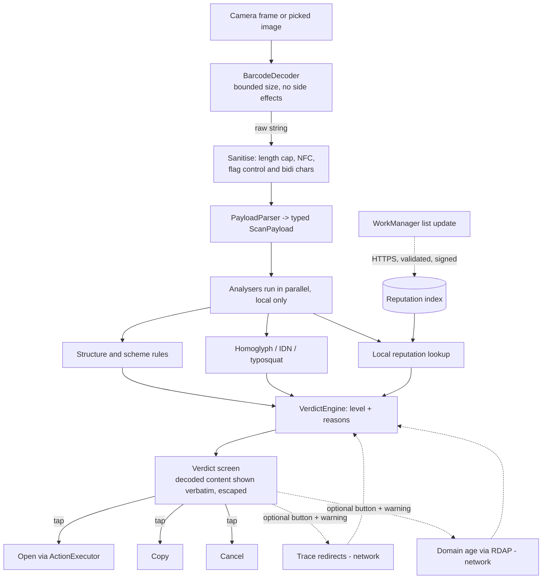

# LookFirst architecture

Status: proposed (LF-1). Stack: Kotlin, Jetpack Compose, MVVM + Clean Architecture, Hilt, minSdk 23.

## Principles

1. **Nothing runs automatically.** A scan only produces a decoded, analysed result. Opening, copying or joining is always a user tap (ADR-0003).
2. **Local by default.** All analysis is on-device (ADR-0001). The only network use is list updates (ADR-0002) and two optional, user-triggered actions (ADR-0004).
3. **Decode, then analyse the decoded structure,** never the raw string. Analysers receive typed objects, not text.
4. **Honest verdicts.** The app never says "safe" (see Verdict model).

## Layers and modules

Gradle modules are suggested; they can start as packages and be split later. Dependencies point inward only: `ui -> domain <- data`.

| Layer | Module / package | Responsibility |
|---|---|---|
| Presentation | `ui` (Compose, ViewModels) | Camera screen, verdict screen, action buttons, settings, history screen |
| Domain | `domain` (pure Kotlin, no Android) | Models (`ScanPayload`, `Verdict`, `Reason`), use cases (`AnalyzeScan`, `ResolveRedirects`, `LookupDomainAge`), analyser interfaces |
| Domain | `domain.decoder` | `PayloadParser`: raw string -> sealed `ScanPayload` (Url, Wifi, Sms, Tel, Mail, Geo, Otpauth, Epc, Crypto, AppLink, Text, Unknown). Strict size and charset limits |
| Domain | `domain.analysis` | Analysers, each `ScanPayload -> List<Signal>`: `UrlStructure` (userinfo `@` tricks, IP host, odd ports, shorteners), `HomoglyphIdn` (punycode, mixed scripts, confusables, bidi), `Typosquatting` (edit distance vs an embedded brand list), `Reputation` (local list lookup), per-type rules (`WifiRules`, `OtpauthRules`, `PaymentRules`, `SchemeRules`, `SmsRules`) |
| Domain | `domain.verdict` | `VerdictEngine`: merges signals into a level and ordered reasons |
| Data | `data.scan.camera` | CameraX + `BarcodeDecoder`, frame analysis, torch |
| Data | `data.scan.image` | Photo Picker / `ACTION_OPEN_DOCUMENT`, bounded bitmap decoding, same decoder |
| Data | `data.reputation` | Compact on-disk index, `ReputationStore`, `ListUpdater` (WorkManager) |
| Data | `data.network` | The only package that talks to the network: `ListDownloader`, `RedirectTracer`, `RdapClient` (OkHttp, no cookies, no auth, fixed generic UA, `Proxy.NO_PROXY`, filtering `Dns`, see Network rules) |
| Data | `data.history` | Optional local history (Room, off by default) |
| Data | `data.launcher` | `ActionExecutor`: builds and fires Intents, clipboard, Wi-Fi suggestion. Only reachable from a UI tap |
| DI | Hilt modules | Bind interfaces; test fakes swap in |

Decoder choice (decision D11): ZXing-core (Apache-2.0, small, fully offline, works at minSdk 23) behind a `BarcodeDecoder` interface. ML Kit is ruled out.

## End-to-end flow



Dotted edges are the only network paths. Re-running the verdict after an optional action produces a new `Verdict` bound to the same payload id (the displayed content does not change); it adds signals and never removes the confirmation step.

## Verdict model

```
Verdict(level, reasons: List<Reason>, payload)
Reason(code, severity, messageResId, shortLabelResId, evidence)   // evidence = exact fragment, e.g. the suspicious host
Severity = INFO | CAUTION | SUSPICIOUS | DANGEROUS
```

| Level | Meaning | Typical triggers |
|---|---|---|
| `DANGEROUS` | Strong evidence of malice | Host in reputation list; `javascript:`, `intent:`, `file:`, `content:` payloads; bidi override in host |
| `SUSPICIOUS` | One strong or several risk signals | Look-alike of a known brand; mixed-script host; IP-literal host; inconsistent payment data; otpauth with odd parameters |
| `CAUTION` | Weak signals, look carefully | URL shortener; plain HTTP; very long URL; open Wi-Fi; unknown app scheme; analysis incomplete; lists stale |
| `NO_RISK_SIGNAL` | Nothing found by LookFirst's checks | Label: "No risk signal detected" |

Rules:
- The level is the maximum severity of the reasons, `INFO` excluded: an `INFO` reason (for example `REDIRECT_FINAL`, the final destination found by tracing) is displayed but never raises the level. Reasons are sorted by severity and written as full plain sentences ("The address looks like paypal.com but uses a Cyrillic 'a'").
- Never the words "safe" or "secure", no green padlock. `NO_RISK_SIGNAL` always carries: "This does not guarantee the site is safe. Lists only know threats that were already reported."
- Every verdict shows the decoded content verbatim, escaped, with bidi/control characters made visible (`<U+202E>`), so the user can verify what the analyser saw.
- Unknown or unparsable content defaults to `CAUTION`, never `NO_RISK_SIGNAL`.
- Reasons are stable codes mapped to string resources (FR/EN).

## Where the network is used, and when

| Use | Trigger | Data sent | Seen by | Default |
|---|---|---|---|---|
| Reputation list update | WorkManager periodic (unmetered, daily) + manual "update now" | Nothing about scans: a plain GET (IP, generic UA) | Codeberg (hosts the bundle; sees the phone's IP, to mention in the privacy notice) | On, explained at first run; can be disabled |
| Redirect tracing | User taps "Trace redirects" after a warning | Requests to the scanned URL and each hop | **The attacker's server** (IP, timing, proof the QR was scanned) | Off, per use |
| Domain age (RDAP) | User taps "Check domain age" after a warning | Registrable domain only (computed with the Public Suffix List), to the `https` RDAP server given by the IANA bootstrap | RDAP registry | Off, per use |

Everything else works in airplane mode. An instrumented test should assert that a scan with the network blocked still yields a verdict.

### Network rules (redirect tracer and RDAP)

- Global Network Security Config forbids cleartext. A hop to `http://` is **not followed**: it is displayed as a risk signal ("this link redirects to an unencrypted address").
- OkHttp with `followRedirects(false)` and `followSslRedirects(false)`; hops are followed manually (max 5, 5 s total), `https` only.
- `Proxy.NO_PROXY`, no cookies, generic User-Agent, no body read (HEAD, fallback `GET` with `Range: bytes=0-0`).
- A custom `Dns` implementation resolves the host, checks every returned address and returns only those checked, so the checked IP is the connected IP (no DNS rebinding gap). Blocked ranges: IPv4 private (10/8, 172.16/12, 192.168/16), 0.0.0.0/8, 100.64/10 (CGNAT), loopback, link-local (169.254/16, fe80::/10), multicast, IPv6 ULA (fc00::/7) and loopback, and IPv4-mapped IPv6 (`::ffff:a.b.c.d`, checked as the embedded IPv4).
- The same client rules apply to RDAP. RDAP URLs must be `https`.

## Opening content (Android specifics)

`ActionExecutor` rules (details in the threat model):
- Build Intents from parsed fields, never from the raw string via `Intent.parseUri`.
- http/https: the analysed URL is converted to canonical form (host as punycode, URL percent-encoded) and `Uri.getHost()` is re-checked to equal the analysed host just before the Intent. `ACTION_VIEW` with `CATEGORY_BROWSABLE`. A verified App Link could be captured by a non-browser app, so LookFirst resolves the default browser and calls `setPackage` on it; if a non-browser handler exists for the URL, the verdict says so. Custom Tab if the browser supports it (declare `<queries>` for `CustomTabsService`); never call `warmup()`, `mayLaunchUrl()` or any prefetch with scanned data. No WebView inside LookFirst.
- tel/sms/mailto: `ACTION_DIAL` (never `ACTION_CALL`), `ACTION_SENDTO` with `smsto:` or `mailto:`; the user still presses send in the target app.
- Wi-Fi: API 30+ `ACTION_WIFI_ADD_NETWORKS` (system confirmation, Intent restricted to system packages). Below 30, show the credentials and open the Wi-Fi settings; never reconfigure silently. No `WifiNetworkSuggestion`.
- geo: `ACTION_VIEW` with a `geo:` URI built from parsed coordinates, sent to the default maps app; the user confirms there, LookFirst fetches nothing.
- otpauth: **Copy only** at MVP (sensitive clip flag). Never an implicit Intent: the URI contains the seed.
- App deep links and unknown schemes (decision D12): **Copy only**, no Open button, no advanced setting.
- No URI permission grants, no `PendingIntent` from scan data, no extras taken from scan data.

## History (optional)

Off by default. When on: Room database with scheme, host, level and timestamp; not the full URL (query strings can carry tokens). Excluded from backup (`allowBackup="false"` and `dataExtractionRules`), one-tap clear, auto-expiry (e.g. 30 days). No extra encryption: the stored data is deliberately low sensitivity.

## Permissions

- `CAMERA` (requested at first camera scan; image scan works without it).
- `INTERNET` (list updates and optional actions).
- No storage permission (Photo Picker / SAF), no location, no contacts, no `QUERY_ALL_PACKAGES`.
- `usesCleartextTraffic="false"` globally via the Network Security Config, no exception anywhere (see threat model T-NET-4).
- Overlays: `filterTouchesWhenObscured` on the Compose root view and `setHideOverlayWindows(true)` on API 31+.

## Reputation bundle pipeline

Lists are produced by a **separate, minimal repository and workflow** (not the app's build CI): pinned upstream fetch -> validation -> reduction to a compact index -> ECDSA P-256 signature -> publication on Codeberg (decisions D10, D13). The signing key is a secret of that workflow's environment only. Details and risks: `threat-model.md` (CI / supply chain) and ADR-0002.

The bundle contains: the reputation index, the Public Suffix List, the IANA RDAP bootstrap file, the top-domains allow-list, and a signed manifest `{version (monotonic integer), generatedAt, files with hashes}`. An initial signed bundle is embedded in the APK so lists are never absent on first launch (ADR-0005). The app rejects a manifest whose version is lower than or equal to the installed one (anti-rollback), and shows the lists' age on every verdict.

## Verdict immutability

While a verdict is displayed, scanning is paused. A second QR in front of the camera never replaces the displayed content; the user must dismiss or act first. The action buttons always apply to the content on screen.

## IDN handling

`java.net.IDN` implements IDNA2003 and `android.icu.text.IDNA` needs API 24+ (minSdk is 23). The app embeds a UTS #46 implementation generated from the official Unicode tables (`domain.host`, ADR-0006; no ICU4J, too heavy). The analysed and displayed host is the normalized one; the browser always receives the canonical form. Showing that form (Unicode and punycode) is the job of the verdict screen (LF-18), not yet of the Result screen.

## Open points

- Brand list for typosquatting: shipped asset (top brands plus FR/EU banks and public services), refreshed inside the signed bundle.
- Choice of the UTS #46 library (LF-3).
